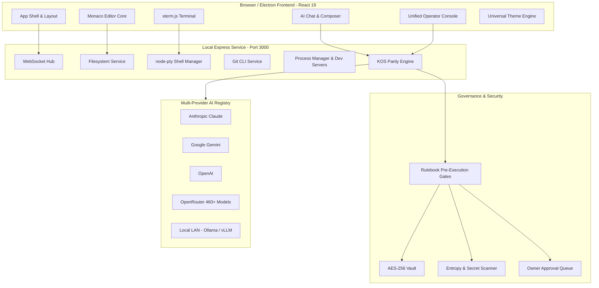

<div align="center">

# 🌌 Nova IDE
### The Complete Cursor-Class AI-First Integrated Development Environment

[](https://www.typescriptlang.org/)
[](https://react.dev/)
[](https://vitejs.dev/)
[](https://microsoft.github.io/monaco-editor/)
[](https://vitest.dev/)
[](https://www.typescriptlang.org/)
[](LICENSE)

*A state-of-the-art, fully autonomous, zero-fake-mock developer workstation uniting real filesystem manipulation, interactive WebSocket PTY terminals, multi-provider BYOK AI orchestration, enterprise governance gates, and instant local session retention.*

---

[Key Highlights](#-key-architectural-highlights) • 
[Feature Matrix](#-comprehensive-feature-matrix) • 
[KOS-Parity Governance](#-section-17e-kos-parity-governance-suite) • 
[Getting Started](#-getting-started) • 
[Shortcuts](#-keyboard-shortcuts) • 
[Architecture](#-system-architecture)

</div>

---

## 🌟 Key Architectural Highlights

- **Zero-Native Dialog Experience**: Chrome-native popups (`showOpenFilePicker`, `showDirectoryPicker`, `window.alert`, `window.confirm`, `window.prompt`) have been permanently removed. Nova features a custom-themed in-app filesystem navigator with path breadcrumbs, drive navigation, recent project bookmarks, and directory creation.
- **BYOK Multi-Provider Hub**: Direct first-class support for **Anthropic (Claude 3.5 Sonnet/Opus)**, **Google Gemini (2.5 Pro / 2.0 Flash)**, **OpenAI (GPT-4o / o1 / o3-mini)**, **OpenRouter (460+ live models catalog)**, and **Local LAN Endpoints (Ollama, LM Studio, vLLM)** with real key verification and live pricing calculation.
- **Real WebSocket PTY Terminals**: Multi-tab terminal driven by real `node-pty` background processes streaming raw xterm.js sessions with full interactive shell support (PowerShell, CMD, Git Bash, WSL).
- **Single Source of Truth Theming**: 60+ meticulously crafted themes (Nova Dark, VS Code Modern, Dracula, Catppuccin, Monokai, Tokyo Night, Solarized, Gruvbox) synchronized instantly across CSS variables, Monaco Editor definitions, and xterm ANSI palettes with pre-paint zero-flash injection.
- **Autonomous & Guarded Execution Modes**: Switch effortlessly between **IDE Mode** (read-only advisory), **Agent Mode** (proposes diffs & executes safe allowlisted commands), and **YOLO Mode** (autonomous iterations with strict security denylists and kill-switch control).
- **Zero-Loss Session Retention & Hot-Exit**: Reopening Nova restores all active tabs, cursor positions, scroll offsets, terminal cwd, active chat context, and unsaved dirty buffers.
- **Enterprise KOS-Parity Governance**: Complete implementation of all 17 advanced governance capabilities: AES-256 Credential Vault, Rulebook Hard Gates, Secret Scanning, Multi-AI Council, and Unified Operator Console.

---

## 🚀 Comprehensive Feature Matrix

### 1. 📝 Monaco Editor Core
- **Full VS Code Language Experience**: Real TypeScript, JavaScript, Python, JSON, CSS, and HTML language diagnostics and syntax highlighting.
- **Advanced Editing Tools**: Multi-cursor support, bracket pair colorization, indentation guides, code folding, minimap toggle, and breadcrumbs navigation.
- **Quick Navigation**:
  - `Ctrl + P`: Quick Open file search with fuzzy filtering.
  - `Ctrl + Shift + P`: Unified Command Palette.
  - `Ctrl + Shift + O`: Workspace symbol lookup.
  - `Ctrl + F` / `Ctrl + H`: High-speed Find and Replace with RegEx support.
- **Side-by-Side Diff Viewer**: Split diff comparisons for reviewable AI changes and git unstaged edits with atomic Accept/Reject actions.

### 2. 💬 AI Chat & Conversation Hub
- **Conversation-First UX**: Minimalist, clutter-free chat interface inspired by Cursor and ChatGPT. No decorative dashboard widgets or simulated outputs.
- **Full-Fidelity Streaming Engine**: Robust SSE parser handling split UTF-8 chunks, mid-stream keep-alive notices, token counters, and cost metrics without raw JSON artifacts.
- **Context-Aware Composer**:
  - `@` Mentions: Attach active files, specific folders, git diffs, terminal outputs, or workspace symbols directly into context.
  - `/` Slash Commands: Trigger specialized agent workflows (e.g., `/plan`, `/review`, `/test`, `/fix`).
  - Image and file drag-and-drop attachments.
- **Contextual Code Block Actions**: One-click **Apply to File**, **Insert at Cursor**, **Review Diff**, or **Copy Code**.
- **Persistent Chat History**: Local indexed storage with search, conversation renaming, branching, and workspace association.

### 3. ✨ Cursor-Style AI Features
- **Inline Code Editing (`Ctrl + K`)**: Select any code snippet or place your cursor, provide an instruction, and review inline diff proposals directly within Monaco.
- **Tab Ghost-Text Autocomplete**: Fast inline AI completions with debounced background model requests and multi-token Tab accept.
- **Terminal Natural Language AI (`Ctrl + K` in Terminal)**: Convert natural language requests into verified shell commands with mandatory approval before execution.
- **AI Commit Generator**: Automatically analyze staged git diffs and produce conventional, high-quality git commit messages.
- **Semantic Codebase Search (`@codebase`)**: Query your entire workspace using an AST-indexed keyword and symbol search engine.

### 4. 💻 Real Terminal, Process & Git Management
- **Interactive Multi-Session PTY**: Spawns real OS terminal sessions streaming over WebSockets. Supports terminal resizing, custom shells, ANSI colors, and copy-paste.
- **Real-Time Git Integration**:
  - View modified, staged, untracked, and deleted files.
  - One-click Stage / Unstage / Discard changes.
  - Branch creation, checkout, commit, push, and pull with real output diagnostics.
- **Managed Dev Servers & Ports Panel**:
  - Start, monitor, and terminate background development processes.
  - Automatic port readiness detection and active port listener status.
- **Problems & Test Output Panels**:
  - Real tsc and linter problem tracking with click-to-navigate code coordinates.
  - Test runner integration with live pass/fail result visualization.

### 5. 🎨 Universal Theme Engine (60+ Curated Themes)
Single-source-of-truth registry dynamically synchronizing CSS root tokens, Monaco editor syntax colors, and xterm terminal palettes:
- **Dark Themes**: Nova Dark (Default), VS Code Dark+, One Dark Pro, Dracula, Dracula Soft, Monokai, Monokai Pro, Monokai Dimmed, Nord, Tokyo Night, Tokyo Night Storm, Catppuccin Mocha, Catppuccin Macchiato, Catppuccin Frappé, Gruvbox Dark (Hard/Medium/Soft), GitHub Dark, GitHub Dark Dimmed, Material Ocean, Material Palenight, Night Owl, Ayu Dark, Ayu Mirage, Rosé Pine, Rosé Pine Moon, Synthwave '84, Cobalt2, Shades of Purple, Poimandres, Cursor Dark, and more.
- **Light Themes**: Nova Light, VS Code Light+, GitHub Light, Solarized Light, One Light, Catppuccin Latte, Gruvbox Light, Tokyo Night Light, Ayu Light, Rosé Pine Dawn.
- **High Contrast**: High Contrast Dark, High Contrast Light, and Color-Blind Friendly palettes.
- **Zero-Flash Pre-Paint Execution**: Inline boot script restores chosen theme before first DOM paint to prevent flash-of-white.

### 6. 🕒 Work History, Local Timeline & Checkpoints
- **Independent File Snapshots**: Automatically snapshots files on every user save and before/after every agent turn, independent of Git.
- **File Timeline View**: Browse historical snapshots with timestamped diffs and one-click file restoration.
- **Per-Turn Agent Checkpoints**: Grouped atomic undo for multi-file AI edits with one-click full-workspace rollback.
- **Hot-Exit Crash Recovery**: Persistently caches unsaved buffer changes, prompting seamless resolution upon reload if external disk modifications occur.

### 7. 📦 Multi-Stack Profiles & Polyglot Engine
Automatic project stack profiling without scattered hardcoded conditions:
- **Web & JavaScript**: React, Next.js, Vite, Vue, Nuxt, Svelte, Angular, Express, Fastify, NestJS, Bun, Deno.
- **Python**: Django, Flask, FastAPI, Poetry, uv, Pipenv, requirements.txt.
- **Systems & Backend**: Go (`go.mod`), Rust (`Cargo.toml`), Java/Kotlin (`pom.xml`, Gradle), .NET (`.csproj`, `.sln`), PHP (`composer.json`), Docker (`docker-compose.yml`).
- **Monorepos**: pnpm workspaces, npm workspaces, Turborepo, Nx, and Cargo workspaces.
- **Automated Tooling Detection**: Automatically selects the proper package manager (`pnpm`, `bun`, `yarn`, `npm`, `cargo`, `pip`) and identifies `dev`, `build`, `test`, and `lint` commands.

---

## 🛡️ Section 17E: KOS-Parity Governance Suite

Nova IDE integrates an enterprise-grade operational governance suite with a zero-trust security architecture. The AI agent is untrusted by default; all policies, gates, and secrets are enforced server-side.

| Feature | Service | Capability & Implementation |
|---|---|---|
| **1. Credential Vault** | `credentialVaultService.ts` | AES-256-GCM encrypted keystore. Raw secrets are never exposed to LLMs. Agents use `vault:name` references; the backend injects credentials at runtime while automatically redacting secret values from logs, terminal outputs, and chat transcripts. |
| **2. Rulebook Engine** | `rulebookEngine.ts` | Hard pre-execution gates configured via `.nova/rulebook.yaml`. Enforces strict blocks on `.env` file modifications, `git push --force`, out-of-workspace writes, and unapproved dependency installs. Owner-override required for bypass. |
| **3. Secret & Tamper Scanner** | `secretScannerService.ts` | Real-time Shannon entropy analysis and regex scanning for AWS, OpenAI, GitHub, and private keys. Tamper detection maintains SHA-256 manifests of protected configurations (`.novarules`, rulebooks, lockfiles). |
| **4. Multi-AI Council** | `multiAiCouncilService.ts` | Multi-model deliberation engine. Distributes architecture questions and code reviews across up to 4 models simultaneously (proposer, critic, reviewer, judge) with consensus summaries and dissent tracking. |
| **5. Scoped Persistent Memory** | `persistentMemoryService.ts` | Multi-layered memory store (User, Workspace, Business) for architectural decisions, coding preferences, and facts. Injected into context with visible chips; never stores secrets. |
| **6. Skill Sets Engine** | `skillSetService.ts` | Modular workspace skills defined with `SKILL.md` bundles containing domain triggers, instructions, and tool constraints. Supports custom `/slash-commands`. |
| **7. Multi-Business Trackers** | `businessTrackerService.ts` | 6 isolated business slots with independent Kanban task trackers, credential boundaries, and budgets. Prevents context cross-contamination. |
| **8. Owner Approval Queue** | `approvalQueueService.ts` | Unified decision queue for high-risk operations (destructive commands, cloud deployments, vault access). Zero automated approvals while the owner is away. |
| **9. Self-Healing Jobs** | `backgroundJobScheduler.ts` | Backend cron scheduler with exponential backoff, circuit breakers, and dead-letter queues for automated index refreshes, CVE audits, and test suites. |
| **10. PR Automation** | `prAutomationService.ts` | Automated branch management, PR draft generation, AI inline code reviews, and policy-checked merges using Git tokens or GitHub CLI. |
| **11. Task-Based Model Router** | `modelRouterService.ts` | Intelligently routes tasks (autocomplete, chat, planning, code review) to optimal models based on latency, cost ceilings, and tool capabilities with automated fallback chains. |
| **12. Local AI LAN Nodes** | `localAiNodeService.ts` | Cluster registry for local and private network GPU instances (Ollama, LM Studio, vLLM) with automated health pings, latency tracking, and offline failover. |
| **13. Real-Time Ops Visibility** | `opsVisibilityService.ts` | Real-time metrics dashboard visualizing running background tasks, queue depth, token usage, API latency, gate violations, and an immutable audit log. |
| **14. Safe Automation Suite** | `automationToolService.ts` | Browser testing via Playwright in isolated sandboxes, Android ADB emulator integration, and desktop automation guarded by domain allowlists and an instant kill-switch. |
| **15. Knowledge Graph Engine** | `knowledgeGraphService.ts` | AST-driven symbol dependency graph mapping imports, classes, functions, and callers across the entire codebase with interactive querying. |
| **16. Semantic Versioning** | `versioningService.ts` | Automated semantic version calculation, conventional changelog generation, and version rollback management. |
| **17. Unified Operator Console** | `OperatorConsoleView.tsx` | All-in-one central control panel unifying the vault, rulebook, approval queue, background jobs, memory, and ops metrics in a single interface. |

---

## ⌨️ Keyboard Shortcuts

| Shortcut | Action | Scope |
|---|---|---|
| `Ctrl + P` | Quick Open File | Global |
| `Ctrl + Shift + P` | Command Palette | Global |
| `Ctrl + Shift + O` | Workspace Symbol Search | Monaco Editor |
| `Ctrl + L` | Open AI Chat & Attach Selection | Global / Editor |
| `Ctrl + K` | Inline Code Edit / AI Terminal Prompt | Monaco / Terminal |
| `Ctrl + \`` | Toggle Integrated Terminal | Global |
| `Ctrl + B` | Toggle Left Sidebar | Global |
| `Ctrl + S` | Save Active File & Snapshot to History | Monaco Editor |
| `Ctrl + Shift + S` | Save All Open Files | Monaco Editor |
| `Ctrl + Shift + F` | Global Workspace Search & Replace | Global |
| `Ctrl + Tab` | Switch to Next Open Tab | Editor Tabs |
| `Escape` | Close Modal / Cancel Generation | Modals / Chat |

---

## 🛠️ System Architecture



---

## 🏁 Getting Started

### Prerequisites
- **Node.js**: v18.0.0 or higher
- **Git**: Installed and available in your system path
- **Package Manager**: `npm`, `pnpm`, or `bun`

### Installation & Launch

1. **Clone the repository**:
   ```bash
   git clone https://github.com/rexmoeed/NovaIDE.git
   cd NovaIDE
   ```

2. **Install dependencies**:
   ```bash
   npm install
   ```

3. **Start Nova IDE**:
   ```bash
   npm run dev
   ```

4. **Access the IDE**:
   Open your browser and navigate to:
   ```text
   http://localhost:3000
   ```

### Running Tests & Verification

Verify the entire codebase with the complete automated test suite:

```bash
# Run unit & integration test suites (158 passing tests)
npm test

# Run TypeScript compilation check (0 errors)
npx tsc --noEmit

# Build production bundle
npm run build
```

---

## 🖥️ Desktop Packaging (Electron)

Nova IDE is architected for dual-target distribution as a local web application and as a standalone Windows desktop executable (`.exe`).

### Building the Desktop Executable
```bash
# Package portable executable and NSIS installer
npm run electron:build
```

The Electron build leverages:
- `electron/main.ts`: Starts the local backend on `127.0.0.1` with a random port and secure session token.
- `electron/preload.ts`: Narrow, context-isolated bridge exposing IPC communication.
- `electron-builder`: Generates optimized standalone Windows `.exe` installers with system tray integration.

---

## 📄 License

Nova IDE is licensed under the [MIT License](LICENSE).

---

<div align="center">
Built with ❤️ for developers who demand real tools, zero simulated answers, and uncompromising AI control.
</div>
